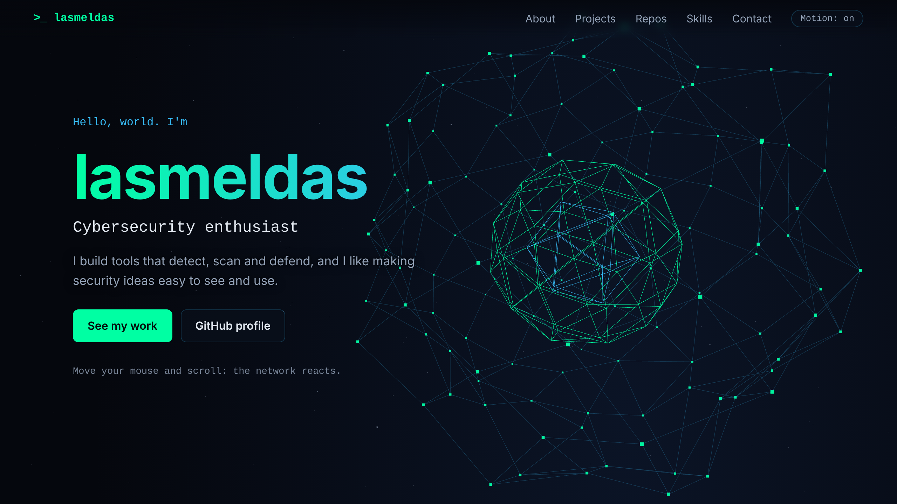

<p align="center">
  
</p>

<p align="center">
  <a href="https://lasmeldas.github.io/cyber-portfolio-3d/"><b>Live demo</b></a> &nbsp;·&nbsp;
  <a href="#features">Features</a> &nbsp;·&nbsp;
  <a href="#quick-start">Quick start</a> &nbsp;·&nbsp;
  <a href="#customize">Customize</a> &nbsp;·&nbsp;
  <a href="#deploy-to-github-pages">Deploy</a>
</p>

<p align="center">
  
  
  
  
</p>

<p align="center">Built by <a href="https://github.com/lasmeldas"><b>Beamlak</b></a></p>

<p align="center">
  <a href="https://lasmeldas.github.io/cyber-portfolio-3d/">
    
  </a>
</p>

A personal portfolio that opens on a live 3D scene: a glowing wireframe core inside a network of linked nodes that follows your mouse and rotates as you scroll. It is plain HTML, CSS and JavaScript with a single CDN import, so there is nothing to install or build.

## Features

- **3D hero scene** built with WebGL: a counter-rotating core, a linked node network and a starfield.
- **Interactive:** the camera eases toward your pointer, and scrolling rotates the network.
- **Live project list:** the "Latest on GitHub" section reads your public repositories from the GitHub API, so new work appears without editing the page. Forks, archived repos and the profile repo are skipped, and results are cached for 10 minutes to stay under the API's rate limit.
- **Accessible:** a **Motion** button pauses all animation, `prefers-reduced-motion` starts it paused, and focus styles and contrast are kept readable.
- **Resilient:** without WebGL the page still works, and if the GitHub API is unavailable the section shows a short message instead of breaking.
- **Responsive:** on phones the network moves below the text so nothing is hard to read.
- **Shareable:** Open Graph tags and a favicon, so links look good when pasted into chats and social feeds.

## Quick start

ES modules need a web server, so opening `index.html` directly won't work. From the project folder:

```bash
python3 -m http.server 8000
```

Then open http://localhost:8000.

## Customize

| What | Where |
|------|-------|
| Name, text, featured projects, links | `index.html` |
| Colors, spacing, fonts | CSS variables at the top of `style.css` |
| Node count, radius, scene colors | `NODE_COUNT`, `RADIUS`, `GREEN`, `CYAN` at the top of `main.js` |
| Typed roles | the `roles` array in `startTyping()` in `main.js` |
| Which GitHub account is listed | `OWNER` at the top of `main.js` |

## Deploy to GitHub Pages

1. Open **Settings → Pages** in your repo.
2. Under **Build and deployment**, choose **Deploy from a branch**, then select `main` and `/ (root)`.
3. Push to `main`. The site appears at `https://<your-username>.github.io/<repo>/`.

**If the site doesn't load yet:** the first build can take a few minutes. Watch **Actions → pages build and deployment**. When it shows a green check, hard-refresh the page (Ctrl+Shift+R). The Pages settings screen says "Your site is live at ..." once it's ready. The Save button stays greyed out unless you change a setting, which is normal.

## Project structure

```
cyber-portfolio-3d/
├── index.html    # content, meta tags, import map
├── style.css     # theme, layout, animation
├── main.js       # Three.js scene, typing effect, motion toggle, GitHub repo list
├── .nojekyll     # tells GitHub Pages to skip Jekyll and serve files as they are
├── docs/         # README banner and screenshot
├── LICENSE
└── README.md
```

## Tech

[Three.js](https://threejs.org/) r160, loaded from jsDelivr through an import map, plus the public [GitHub REST API](https://docs.github.com/en/rest). No framework, bundler or package manager.

## License

[MIT](LICENSE)

---

<p align="center">Built by <a href="https://github.com/lasmeldas"><b>Beamlak</b></a> &middot; <a href="https://github.com/lasmeldas">github.com/lasmeldas</a></p>
